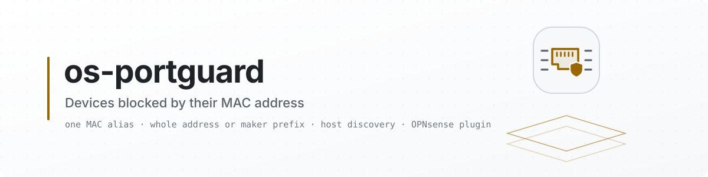

<picture>
  <source media="(prefers-color-scheme: dark)" srcset="docs/images/readme/banner-dark.svg">
  <source media="(prefers-color-scheme: light)" srcset="docs/images/readme/banner-light.svg">
  
</picture>

<p align="center">
  <a href="https://github.com/AbdelmonemAwad/os-portguard/releases/latest"></a>
  <a href="https://github.com/AbdelmonemAwad/os-portguard/actions/workflows/checks.yml"></a>
  <a href="LICENSE"></a>
  <a href="#what-is-tested"></a>
  <a href="https://github.com/AbdelmonemAwad/opnsense-arabic"></a>
  <a href="https://github.com/AbdelmonemAwad/os-xgs-npu"></a>
  <br>
  <a href="#what-is-tested"></a>
  <a href="#what-is-tested"></a>
  <a href="#not-yet-and-why"></a>
</p>

# Port Guard for OPNsense

~~Layer 2 rules for the ports of the firewall: a device allowed or blocked inside the network by its MAC address or by the type of frame it sends, before the IP rules see it - and, on a Sophos XGS, in its switch where the switch can enforce them.~~ A device inside the network blocked by its MAC address - or every device of one maker, by the first bytes of the address - at the firewall: OPNsense resolves the addresses listed into the IP addresses the devices use, and the firewall's IP rules block those. Not done (2026-10-29): allowing only the devices listed, which is not written; and matching a frame by its type or blocking in an XGS's switch - see [Not yet, and why](#not-yet-and-why).

> ~~**Planned - nothing here runs yet.** This repository was opened on 2026-10-22 to hold
> Port Guard as a plugin of its own. No code has been written or moved into it, and there is no
> release.~~
>
> ~~**Written, not released (2026-10-22): the first part.** A device blocked by its MAC address, at the
> firewall. There is no release, and it has not been installed on an appliance yet. What was run is
> listed under [What is tested](#what-is-tested); what the rest needs is under
> [Not yet, and why](#not-yet-and-why).~~
>
> **1.0.1 (2026-10-30):** a device listed loses its open connections, `configctl portguard apply` does the whole job, the table emptied when no device is left, and a removal that leaves nothing behind. ~~Tested in qemu on OPNsense 26.7.7 before the release; see~~ Tested in part before the
> release, in qemu on OPNsense 26.7.7 from the branch that became it; what ran and what did not
> is under [What is tested](#what-is-tested).
>
> **1.0.0, the first release (2026-10-25): the first part**, a device blocked by its MAC address at
> the firewall. Installed and its page opened on an XGS 3300 (OPNsense 26.7.7) before the release;
> ~~no device has been blocked through it yet~~ - since, on 2026-10-29 in qemu, two were: qemu's
> gateway on the LAN, and a second machine (see [What is tested](#what-is-tested)). Updated from
> XGS: Updates when os-xgs-npu is installed, or by its own self-update - see [Updates](#updates).
> What the rest needs is under [Not yet, and why](#not-yet-and-why).

<p align="center"><b>Contents:</b> <a href="#what-it-does">What it does</a> &middot; <a href="#not-yet-and-why">Not yet, and why</a> &middot; <a href="#what-is-tested">What is tested</a> &middot; <a href="#installation">Installation</a> &middot; <a href="#updates">Updates</a> &middot; <a href="#where-it-fits">Where it fits</a> &middot; <a href="#licence">Licence</a></p>

## What it does

**Firewall: Port Guard** (XGS: Port Guard when os-xgs-npu is installed):

- **blocked devices** - a list of MAC addresses, each a whole address or its first three to five
  bytes (every device of one maker). The plugin keeps one MAC alias, `portguard_blocked`, from the
  list; OPNsense resolves it into the IPv4 and IPv6 addresses its ARP and NDP tables - or its host
  discovery - have seen each device use, and keeps them current;
- **the rules** - registered by the plugin at every filter reload (`plugins.inc.d/portguard.inc`, as
  os-crowdsec does): nothing from a listed device passes the firewall, on any interface, and nothing
  reaches it through the firewall. They come before the interface rules, the anti-lockout rule
  included, and are never added to the owner's own rules;
- **open connections cut** - a rule stops new connections only. The connections a listed device
  already has open are cut when Apply puts it into the firewall, and every minute those to or from
  an address the alias has just gained (`cut.py`, from a cron entry); always on. On an XGS,
  os-xgs-npu's drivers take a connection out of the coprocessor once pf no longer holds its state.
  Written on 2026-10-29, after the tests below - until then nothing cut a connection already open,
  and it went on - and ~~not yet tested~~ tested at Apply that evening, in qemu (below); the cut
  every minute not yet;
- **devices seen** - the devices the firewall has seen in the last day, with their interface,
  address and maker, each a click from being blocked; the cards say how many listed devices are
  present and how many addresses pf blocks now.

~~a page in the XGS section of OPNsense's menu~~ - it is under **Firewall**, beside Block Lists (under
**XGS** when os-xgs-npu is installed): it is not for XGS appliances only.

## Not yet, and why

~~rules by MAC address and by frame type, written as pf's Ethernet rules~~ - OPNsense does not write
Ethernet rules: its `filter.inc` assembles pf.conf from options, tables, scrubbing, translation and
filter rules, and the anchors a plugin may register are of those kinds only (`nat`, `binat`, `rdr`,
`fw`; read in opnsense/core stable/26.7 on 2026-10-22). pf takes its `ether` rules from the main
ruleset, so a plugin cannot add them without a change to OPNsense itself. Until then:

- **two devices behind the same switch still reach each other** - their frames never come to the
  firewall. Except on an XGS 3300's or XGS 136's own front ports, measured 2026-10-25: a frame for
  the device on another front port never crosses inside the switch but goes to the coprocessor, and
  traffic routed between two front ports meets the firewall's rules
  ([os-xgs-npu's measurement](https://github.com/AbdelmonemAwad/os-xgs-npu/blob/main/docs/measurements/frontports-2026-10-25.md));
- **a frame type** (an EtherType) cannot be matched at all;
- **a device that changes its MAC address** (private Wi-Fi addresses) is blocked ~~only under the one
  listed~~ under the one listed, and - measured on 2026-10-29 in qemu, see
  [What is tested](#what-is-tested) - under the IPv4 address it used with it, for as long as
  OPNsense's host discovery holds the two together: one that took another MAC address but kept its
  IPv4 address stayed blocked, through nine minutes and a refresh of the aliases; with a new IPv4
  address as well it was reached at once. Not measured: by the same holding, another device given
  that IPv4 address afterwards would be blocked too, until the old pair is let go.

~~on a Sophos XGS, the rules the 88E6193X switch can hold, kept in the switch, so a blocked device is
stopped at the port~~ - still the aim, not written: the XGS 136's and 3300's front ports are on the
88E6193X behind the coprocessor, reached through os-xgs-npu's switch tool. ~~which of the switch's
address-table entries or port policies can discard a source address is research not yet done~~ -
read on 2026-10-22 (~~os-trafficpriority's docs/research.md~~
[os-xgs-npu's discoveries of that day](https://github.com/AbdelmonemAwad/os-xgs-npu/blob/main/docs/findings/discoveries-2026-10-22.md#the-tcam-254-of-256-entries-are-the-vendors)):
the switch's TCAM matches a frame's first 48 octets under a mask - its MAC addresses and its EtherType
among them - and one of its actions sends the frame to no port. That is both halves of this plugin's
aim at the port itself~~, and it would stop the frames between two devices too~~ (those already pass
the coprocessor, above); ~~writing it goes through os-xgs-npu, which is not to be changed until its
owner decides~~ but 254 of its 256 entries are already the vendor's, read the same day - entries 3
and 255 are free - so the TCAM is not free to use for this plugin's rules.

## What is tested

On the second XGS 3300, 2026-10-22, from a copy in `/tmp`, nothing installed and config.xml not
written:

- every PHP file and the rules hook pass `php -l`; both Volt templates compile;
- `status.py` read the devices through OPNsense's `list_hosts.py` (host discovery: 25 in the last
  day, each with its interface, address and maker) and pf's table;
- the rules hook, called as a filter reload calls it: no rule, as no device was listed.

On the first XGS 3300, 2026-10-25, OPNsense 26.7.7 with os-xgs-npu installed, before the release:

- installed by `install/install.sh`: rc 0, its PHP passing `php -l` in the installer;
- the page opened in the browser, its summary cards reading the status;
- its menu place: under **XGS** with os-xgs-npu installed; in its own section, **Firewall**, when
  os-xgs-npu's menu file was set aside, and back under XGS when it was put back (`place-menu.sh`).

On a plain OPNsense 26.7 in qemu, 2026-10-29: the nano image with nothing of os-xgs-npu on it. The
device on its LAN was qemu's own gateway there, 192.168.1.2, through which the host's web server
answers. It was listed by its MAC address through the plugin's model and applied the way the page's
Apply does: `configctl portguard apply`, then `filter reload skip_alias`, `template reload
OPNsense/Filter` and `filter refresh_aliases`.

- **The package.** `os-portguard-1.0.0.pkg` and `SHA256SUMS` were fetched from the release and the
  sum checked OK. `pkg add` returned 0, and the page is under Firewall > Port Guard.
- **The alias.** apply answered `portguard_blocked: added, 1 device(s)`, and OPNsense resolved the
  MAC address to 192.168.1.2. The rules are not in pf after apply alone; the page's filter reload is
  what puts them there. (Since 2026-10-29 `configctl portguard apply` runs those reloads itself, as
  the page's Apply now does through it; ~~not yet tested~~ tested that evening, below.)
- **The rules.** pf holds `block drop in quick from <portguard_blocked>` and `block drop out quick
  to <portguard_blocked>`, for inet and for inet6.
- **A device blocked.** The web server was reached before; while the device was listed it was not
  reached; and once the device was removed and applied again, it was reached again.
- **A separate machine.** A second ~~such~~ machine, a copy of the first once it ran OPNsense 26.7.7 -
  this test and the next ran on 26.7.7, not 26.7 - joined to it by a cable of
  their own - an interface of its own on each, not the LAN. It was listed by its MAC address, read
  from the ARP table, and applied the same way. Before, each machine reached the other (ping). While
  it was listed, the alias resolved to the second machine's address, pf held the four rules, and
  neither reached the other. Once it was removed and applied again, both did again. pf's table kept
  the address after the last device was removed, but no rule referred to it then. (Since 2026-10-29
  the Apply empties the table when no device is left, and the page counts its addresses only while
  a rule uses it; ~~not yet tested~~ the emptied table tested that evening, below, the count not
  yet.)
- **A device that changes its MAC address.** The second machine, listed by its whole address, took
  another one and kept its IPv4 address: it stayed blocked. OPNsense's host discovery still held the
  listed address with that IPv4 address, so the alias kept it - through nine minutes and a refresh
  of the aliases. With another IPv4 address as well, as a new DHCP lease would give it, it was
  reached at once: a device is blocked only under the address listed. Listed by its first four bytes
  instead, it took another address within them and another IPv4 address, and was blocked again 22
  seconds later: the alias had gained the new one.

Not tested: ~~`apply.php` writing the alias (it saves config.xml), a device blocked~~ (on 2026-10-29
in qemu, above), ~~the page in a browser~~ (opened on 2026-10-25, above), ~~the package (built by
`tools/make-package.sh`, added with pkg), and an install on a plain OPNsense, without os-xgs-npu~~
(on 2026-10-29 in qemu, above). Still not: ~~a device that is a separate machine on the LAN~~ (a
second machine, on an interface of its own, on 2026-10-29 in qemu, above), ~~and a device that changes
its MAC address~~ (on 2026-10-29 in qemu, above).

Written after the tests above and ~~not yet tested~~ (2026-10-29), and tested in part that evening,
below: the cut of the connections a listed
device already has open, at Apply and every minute; `configctl portguard apply` doing the whole of
the page's Apply; the table emptied when no device is left, and the page's addresses counted only
while a rule uses the table; the cards counting devices rather than addresses, and the Block
button's answer; the checks before the copy; and the removal's stopping of a running cut, its
deleting of the state and its emptying of a stale table.

1.0.1's branch, run on 2026-10-29 in qemu on OPNsense 26.7.7, before its release commit, with the
second machine listed by its MAC address while it held a TLS connection open:

- **Open connections cut at Apply.** Apply answered `portguard_blocked: 2 new addresses of 2, 2 open
  connections cut`, and the connection held open got no answer from then on; before the device was
  listed, it was answered.
- **`configctl portguard apply` alone.** pf then held the table with the device's two addresses and
  the four rules, and no state with the device was left.
- **The table emptied.** With the device removed and applied again, the table was empty and no rule
  named it.
- **The removal.** Nothing was left: no cron entry, no state, no cut process, an empty table - but the
  table was empty already and no cut was running, so its stopping of a running cut and its emptying
  of a stale table were not exercised, and `pkg delete` was not run.

Still not tested: the cut every minute, the page's addresses counted only while a rule uses the
table, the cards and the Block button's answer, and the checks before the copy.

## Installation

It is not in the OPNsense plugin repository, so there is no `pkg install os-portguard`.

**From a checkout** of this repository, on the firewall, as root:

```sh
sh install/install.sh
```

It ~~copies `src/` onto `/usr/local` (the rules hook with it), checks the PHP and the rules hook with
`php -l` and the Python with `py_compile`,~~ checks the PHP and the rules hook with `php -l` and the
Python with `py_compile` before anything is copied (since 2026-10-29: checked after the copy, a hook
with an error stayed where every filter reload includes it), then copies `src/` onto `/usr/local`
(the rules hook and, since 2026-10-29, the cron entry for the cut with it), puts the page in the menu
(`place-menu.sh`: XGS with os-xgs-npu, Firewall without) and records the commit for the self-update.
Safe to run again: the settings in config.xml are kept. Nothing is blocked until a device is listed
and applied.
`sh install/uninstall.sh` removes the plugin and its rules; the `portguard_blocked` alias stays in
Firewall: Aliases, blocking nothing.

**Before removing it**, turn **Enabled** off and **Apply** to take the alias away as well: the Apply
removes it (switches it off instead when a rule of the owner's names it) and empties its pf table.
The removal itself, by the script or by pkg, stops a cut that is running, deletes what the cut kept in
`/var/db/os-portguard`, and empties the blocked devices' pf table when its alias is gone and no rule
uses it - a table outlives its alias, and went on holding the addresses (all of this since
2026-10-29).

**From a release's package.** A release carries `os-portguard-<version>.pkg` and `SHA256SUMS`,
built by `tools/make-package.sh` in the release workflow; ~~installing it has not been tested yet~~
it was added with pkg on a plain OPNsense on 2026-10-29 - see [What is tested](#what-is-tested).
Check it and read it before adding it, as root:

```sh
sha256sum -c SHA256SUMS
pkg info -lF os-portguard-*.pkg       # every file it will write
pkg add os-portguard-*.pkg
```

`pkg delete os-portguard` takes the rules hook with the files and reloads the filter, so the rules
leave pf; the settings and the `portguard_blocked` alias stay, blocking nothing (see **Before removing
it**, above). The same package is built on the firewall from a checkout with
`sh tools/make-package.sh -o /tmp`.

## Updates

Taken by hand, to this repository's **releases**: from **XGS: Updates**, its *Plugins* tab, where an
[os-xgs-npu](https://github.com/AbdelmonemAwad/os-xgs-npu) that lists this plugin is installed - the
tab calls `/usr/local/opnsense/scripts/portguard/self-update.py`, with `check` to ask and without it
to install - or by running that script. No cron entry runs it. It asks GitHub for the latest release
and, when that is ahead of what is installed, downloads it and runs the `install/install.sh` it
carries - the same script a hand install runs. A change merged on `main` reaches an installed
firewall when it is released, not before.

- **Only forward.** What is installed is recorded in `/usr/local/share/os-portguard/installed.json`
  by the installer: the commit, from a git checkout or from the `.source-commit` stamp an update
  leaves in the tree. A firewall running something newer than the release is not taken back; an
  install with no commit recorded takes the latest release once.
- **A package install records no commit**, so its first self-update takes the latest release and
  installs it with `install/install.sh`, outside pkg. A package is updated with a newer package
  instead: `pkg add -f`.
- **What happened** is in the system log as `self-update`, in
  `/usr/local/share/os-portguard/update.json`, and the installer's output in `update.log` beside it.
- `self-update.py check` says what it would do and changes nothing.

~~Not tested yet: an update taken this way - 1.0.0 is the first release, so none has been ahead of
an installed copy.~~ Tested on 2026-10-29 on a plain OPNsense ~~26.7~~ 26.7.7 in qemu, where the package had
been added with pkg, which records no commit: `self-update.py check` found the release `v1.0.0`
(5353a6423145) and nothing installed to compare it with, so to be taken. `self-update.py` fetched
its source, ran its `install/install.sh` and answered `updated to v1.0.0 (5353a6423145)`, which the
system log has too. `installed.json` then recorded that commit, from the stamp, and a second check
found it identical: nothing to take. ~~Not yet: a release ahead of the one installed - 1.0.0 is
still the only release.~~ Taken on 2026-10-30, on an XGS 3300 with OPNsense 26.7.7: with 1.0.0
installed, `self-update.py`, run over SSH, answered `updated to v1.0.1 (8498e3f5f64a)`, the system
log carries the same line, and `installed.json` recorded that commit.

## Where it fits

It is one part of the [os-xgs-npu](https://github.com/AbdelmonemAwad/os-xgs-npu) project, which puts OPNsense on Sophos XGS hardware, and works the way its other plugins do: changes by pull request, a release installed from **XGS: Updates** (listed there since os-xgs-npu 0.1.0-alpha.8, and installed with the project's update since 0.1.0-alpha.8.2), its Arabic in [opnsense-arabic](https://github.com/AbdelmonemAwad/opnsense-arabic)'s catalogue.

## Licence

BSD 2-Clause - see [LICENSE](LICENSE).
